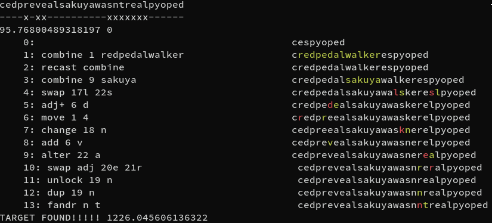

# fleurdream

Solver for [flowereverie](https://store.steampowered.com/app/2672070/Flowereverie/).

This uses deterministic anytime branch-and-bound search with fair turns across
source words. It reports a solution quickly, then keeps looking for strictly
shorter solutions. Choose available spells and flowers on the command line;
omitting selection options uses the current defaults in `solver.py`.

Spoiler alert!!!!!!!

```
pypy3 solver.py startthefestival
```

Python 3 also works. Targets are case insensitive. Press **Ctrl+C** to stop and
return the best solution found so far. There is no automatic time limit.

For difficult long targets, an optional C++17 discovery backend builds
automatically with `c++` (or `$CXX`) and caches its binary in the system temporary
directory. Every solution it returns is independently replayed by the Python
spell rules. Without a compiler, the solver uses Python discovery;
`--python-only` also selects that behavior explicitly.

To stop after the first solution:

```
python3 solver.py recastspell --first
```

Use allowlists to select starting spells and sources:

```
python3 solver.py knock --spells change,adjacent,move,swap --sources lilachangerbloom --first
```

Or use blacklists, which start with **all implemented spells** and **all known
flowers**, including choices disabled in the script's current defaults:

```
python3 solver.py mostfrequent --blacklist-spells find_and_replace,most_frequent,unlock_letter --blacklist-sources heedonicindigo,violeepicturet,sakuya --first
```

Lists accept commas or spaces. `--spells all`, `--spells none` and `--sources all`
are supported. Put the target before selection options. `--help` lists spell
names and known flowers; source allowlists also accept custom words. A flower
selection controls both starting words and combine donors. Blacklisted spells
cannot be restored by recast. Allowlist and blacklist options are mutually
exclusive within each category. Hyphens or underscores in spell names work,
along with aliases such as `adj`, `sub`, `dup`, `fandr` and `recast`.

`New best` reports each improvement. `Best found` means optimality is unproved;
`Proved shortest` means safe bounds have ruled out every shorter continuation.
Proving optimality can take much longer than finding a useful solution.

Lengths count actual spell casts. Recast costs one even though it resets another
spell's `used_` flag. A `combine_drop…` row bundles two casts, so printed history
rows are not always the same as solution length.

The search uses the restored spell immediately after recast. Recast only changes
availability, so postponing it until that use preserves any useful solution.
Older traces with intervening casts remain valid for replay; reported solutions
are reordered by legal replay, and unused recasts can be removed.

The search shares duplicate detection across all source words. Its ordering
heuristic accounts for frozen letters, the absent-letter rule for add/change,
and which spells can supply an insertion or substitution. Remaining find-and-replace
and unlock operations are included when judging intermediate frozen letters. Duplicate can supply
a copy only beside its source letter; recast can restore a spent move. These
affect ordering only, while real casts still enforce the rules and incur costs.
Bit operations compute this distance without allocating a dynamic-programming
matrix for every state.

Local edits get preferred turns. Combine, spellcheck and find-and-replace expand
lazily on regular deferred turns, or immediately when preferred queues empty.
Every legal branch remains searchable, including local setup before a bulk
spell and adding letters outside the target. Exact finishing sequences check
whether add, duplicate or move can fill a one-letter gap, recasting move when
needed. These sequences retain every legal intermediate cast in their histories.

After initial exploration, discovery turns try promising early combinations
and alter→spellcheck preparations that create removable spell words, such as
turning `yop` into `hop`. The more promising family gets turns
first; the other follows in a later batch. Already-queued setups are promoted
without expanding the same state twice. These shortcuts use legal spells and
retain their full histories; the ordinary search queues stay intact.

A bounded alignment search also tries edits suggested by the target. Its longer
fallback prepares two combines, using recast, before spending local editing
spells. It tries every insertion position for those preparations and retains a
small selection per donor family. This avoids losing useful setups merely
because the first donor contributes little immediate progress. Move can also
carry an unwanted letter outside the target window. These discovery passes
never prove impossibility or replace the complete search frontier.

Long targets and repeated-letter targets also get compiled discovery turns.
This bounded search keeps separate quotas for different source combinations
and spent-spell sets, so one promising family cannot crowd out every other
setup. It uses the same spell data and GUI position limit as Python. Its
discarded candidates never contribute to an optimality or infeasibility proof;
the complete Python branch-and-bound search retains that responsibility.

For targets with long repeated letters, discovery can group lock patterns by
the number of locked letters within runs of at least four. Pairs and triplets
retain their exact patterns. This grouping is approximate: the complete search
always retains exact lock positions, and discovered solutions replay the actual
representative's legal casts.

Before reporting an improvement, the solver tries removing steps and legally
replaying the remaining spells with adjusted positions. It keeps a deletion
only if the replay still reaches the target, then repeats. This removes unused
work while preserving padding, freezing, and absent-letter setup when needed.

Pruning uses separate, optimistic letter-count and edit bounds. A branch is
discarded when its casts so far plus a safe lower bound cannot beat the best
solution. While combine, find-and-replace, or recast remain available, only a
universal one-more-cast bound is used. Otherwise the edit relaxation can grant
arbitrary free deletions for spellcheck and relax frozen letters for unlock.
An additional count cap can reject impossible long repetitions even with bulk
spells remaining: local edits create frozen letters, so only combine and unlock
can increase the unfrozen supply for a future find-and-replace.
DROP retains its combine shortcut and also handles boundary letters of valid
flower-name substrings directly, within the position limit.
The richer ordering heuristic never discards a state or proves optimality.

The search remembers the cheapest arrival at each state and reopens a state if
a cheaper path is found. A separate lower-bound queue includes deferred bulk
operations, so they cannot be overlooked when proving the result optimal.

For Python callers, `solve(..., on_solution=callback)` calls
`callback(state, cast_count)` for every improvement. The returned result includes
`state`, `cost`, `optimal`, `interrupted`, and `stop_reason`. Pass
`first_solution=True` for the quick-result mode. `allowed_spells={...}` and
`source_words=(...)` select a configuration without modifying global defaults.

End-to-end regressions use immutable `REGRESSION_CONFIGS` snapshots in
`test_solver.py`: flower lists, initial spell availability and position limits.
Earlier cases keep adjacent swap initially unavailable; MOSTFREQUENT and
SPIKYBETTY enable it. Changing live solver defaults leaves these baselines
intact; update a case's snapshot deliberately when testing a new configuration.

Run the distance, shortest-path oracle, interruption, deferred-operation, and
FREEDOM/COMBINE/KNOCK/CASHMONEY/RECASTSPELL/MOSTFREQUENT/SPIKYBETTY regressions with:

```
python3 -m unittest -v
```

The complete game catalog is `GAME_SPELLS` in `solver.py`: 100 targets extracted
from the installed game's primary spell list. Its independent snapshot and
executable hash are in `fixtures/game_spells.json`; no Steam installation or
player save is needed to run the tests. `SPELLCHECK_WORDS` remains a separate
dictionary so adding targets does not change existing SPELLCHECK behavior.
Its candidates are cached by arrangement length, preserving cascading matches.

The progression audit starts with **no spells** and only **redpedalwalker** and
**lilachangerbloom**. It asks the real solver to reach each target before making
that spell available in the next round. Flowers unlock as follows:

| Flower | Required targets |
| --- | --- |
| cespyoped | LIE |
| tigerwishgrantbud | EXPLOSION and SWIM |
| honeycombbmineraleaf | BRIDGE |
| heedonicindigo | BREAKANDENTER |
| violeepicturet | CASHMONEY and VIOLEEPICTURET |
| sakuya | STARTTHEFESTIVAL and any one of GRABSAKUYASVASE, SUITOFARMOR, NEWWATERTOWER |

WALKTHROUGHWALLS unlocks every source. Non-editing targets grant no unrelated
editing spells. Position limit 33, alphabet, initial flowers and unlock rules
are fixed independently of live CLI defaults. Vase upgrades and other overworld
requirements are not modeled beyond the flower gates above.

Run the full audit:

```
python3 progression.py --report progression-report.json
```

Each target is first tried at earlier technology profiles with small budgets.
Stalled profiles get larger budgets. Every solution is legally replayed and
records the spells and flowers it actually uses. `--minimize` performs additional
bounded searches after discovery; `--minimize-seconds` controls each trial.
`--total-seconds` and `--seconds-per-target` set the audit budgets (defaults
1500 and 240 seconds). Shorter budgets are useful for quick diagnostic runs.
The report keeps incomparable recipes and rejects circular unlock chains;
discovery rounds are not mandatory technology levels. An `inclusion_minimal`
result rules out removing any direct requirement; it
does not prove the smallest number of requirements or the cheapest transitive
unlock chain. Timeouts never count as impossibility or a minimality proof.

The JSON report includes all attempts, configurations, timings, cast counts,
witness histories and unresolved targets. The command exits nonzero unless
all 100 targets were reached. Reports are checkpointed during discovery;
`--resume progression-report.json` validates saved witnesses before continuing.
`--initial-seconds` can skip tiny attempt budgets when resuming difficult targets.
A fresh audit reached **100/100 targets in 1066.7 seconds** on the development
machine, starting with no spells and the two initial flowers. Every discovery
came from a solver search using previously unlocked resources. This includes
11-cast CONTROLTEMPERATURE, 15-cast MOSTFREQUENTLETTER, 13-cast DDDDDDDDDDDIE,
13-cast STARTTHEFESTIVAL and 12-cast WALKTHROUGHWALLS solutions. These are
reachability witnesses; minimum cast counts and dependencies remain unproved.

The fast bootstrap and gate tests run in the ordinary suite. User routes in
`fixtures/known_routes.json` freeze spells, flowers and the GUI position limit
independently of live defaults. To test fresh endgame discovery as well as replay:

```
FLEURDREAM_LONG_ROUTES=1 python3 -m unittest -v test_user_routes
```

`FLEURDREAM_LONG_ROUTE_SECONDS` sets each search budget (default 180 seconds).
The full performance test is opt-in because it takes about 18 minutes on the
development machine:

```
FLEURDREAM_FULL_PROGRESSION=1 FLEURDREAM_PROGRESSION_REPORT=progression-report.json python3 -m unittest -v test_progression.ProgressionTests.test_all_game_spells_are_reachable_with_progression
```

`FLEURDREAM_PROGRESSION_SECONDS` overrides its 1500-second total budget;
`FLEURDREAM_PROGRESSION_TARGET_SECONDS` sets the largest per-attempt budget
(default 240 seconds). These limits belong to the regression harness; the solver
CLI has no automatic time limit. Each harness search runs in a disposable
process group, including any compiled-search child; timeout, proven exhaustion
for a particular profile, and worker errors remain distinct.


